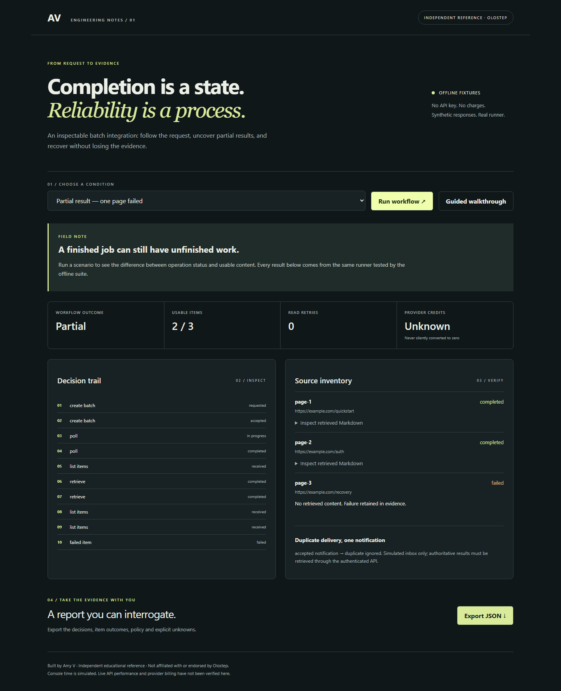
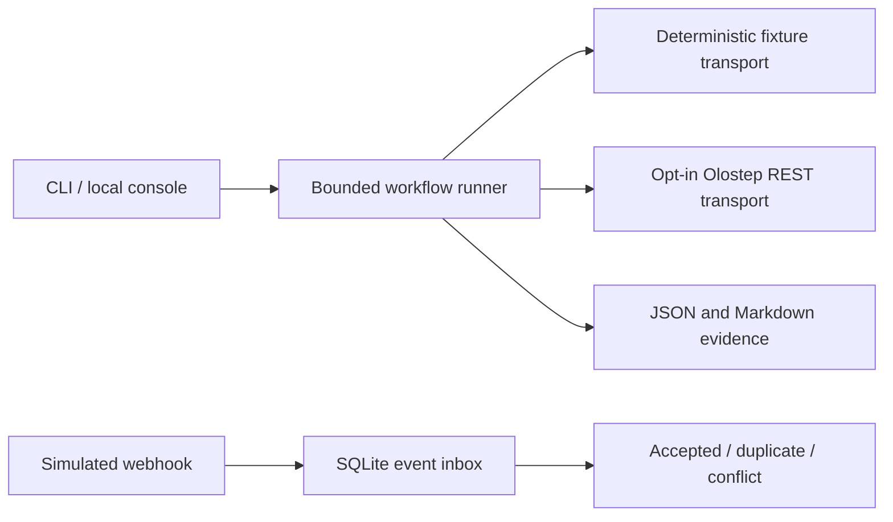

# Olostep Integration Reliability Lab

**A completed operation is not necessarily a complete dataset.**

An independent reference workflow by **Amy V** for developers learning to operate
an asynchronous web-data integration. Submit, poll, paginate, retrieve, inspect
partial results, and export the evidence. Not an official Olostep project or SDK.

## Five-minute quickstart

Requires **Python 3.11+**. No third-party Python packages, credentials, or external
requests are needed for the offline workflow. Git and internet access are needed only to clone the repository. Start in a new working folder:

```sh
git clone https://github.com/Amyvdev1/olostep-integration-reliability-lab.git
cd olostep-integration-reliability-lab
python -m unittest discover -s tests -v
python -m lab --scenario partial
python -m lab --serve
```

Open **http://127.0.0.1:8765** and choose **Guided walkthrough**. The console executes
the same runner as the CLI. Expect two completed items, one failed item, an overall
`partial` result, and `null` credits. CLI evidence is in `output/latest/`.

Use `python3` if your system names Python that way. Expect the test run to end with `OK`. The offline commands do not need `OLOSTEP_API_KEY` and cannot spend credits. Leave the server terminal open while exploring, then stop it with Ctrl+C.

### Read the result before moving on

| Observation | Interpretation | Next action |
| --- | --- | --- |
| `partial`, two completed and one failed item | The workflow finished, but the dataset is incomplete. | Inspect per-item outcomes in the exported report. |
| `null` credits | Usage was not measured in this offline fixture. | Keep it unknown; do not interpret it as zero cost. |
| Exit code 2 on the timeout scenario | The bounded workflow stopped with incomplete evidence. | Resume from the checkpoint below instead of creating another batch. |

If port 8765 is occupied, stop the other local service before starting this console. HookForge's quickstart also uses that port; run the two demos separately. If the browser cannot connect, confirm the server is still running and use the loopback URL above. A saved report can be inspected without the browser.



## What to inspect first

1. `lab/runner.py`: the lifecycle and explicit recovery policy.
2. `lab/fixtures.py`: synthetic responses and reproducible failure cases.
3. `tests/test_workflow.py`: behavior assertions, including restart-safe deduplication.
4. [Technical case study](docs/article-for-hamza.md): the rationale and boundaries.
5. [Walkthrough and interview guide](docs/walkthrough.md): explain each decision.

**Watch:** [Recorded fixture walkthrough](media/walkthrough.mp4). Silent screen
recording with an on-screen guided explanation; no subtitles or impersonated voice.
**Read:** [Technical article for Hamza](docs/article-for-hamza.pdf).

## Try a recovery

```sh
python -m lab --scenario transient
python -m lab --scenario timeout --budget 3
python -m lab --checkpoint output/checkpoints/batch_fixture.json --scenario success
```

The timeout deliberately exits with code **2** and writes an incomplete report.
The checkpoint command performs reads only and verifies the original item identities.
The CLI saves this minimal manifest immediately after creation, before polling.
It contains no URLs, content or credentials. A bare `--resume BATCH_ID` is also
available, but can verify only provider-reported counts without the original manifest.
Exit code 0 means the workflow completed;
check `status` to distinguish `complete` from `partial`.

Other scenarios: `success`, `exhausted`, `unauthorized`, `cursor-loop`,
`missing-content`, `ambiguous-create`. Fixtures are behavioral simulations, not
captures of Olostep incidents. The console uses virtual time so you can explore
deadlines immediately; CLI durations are local elapsed time, not provider latency.

## Optional live path

One bounded live batch was verified on October 14, 2026: two public URLs, actual
cursor pagination and two Markdown retrievals, with matching item identities.
See the [sanitized compatibility report](docs/live-compatibility.md). This does not
validate every failure mode or establish production reliability.
Set `OLOSTEP_API_KEY` privately in your shell. Never paste it into source files,
screenshots or an issue. Only use public URLs you have permission to process.

```sh
python -m lab --live --allow-billable --url https://example.com --budget 600
python -m lab --live --checkpoint output/checkpoints/YOUR_BATCH_ID.json --budget 600
```

Creation is restricted to 1–10 URLs here, deliberately below documented new-account
batch limits. Query strings and embedded credentials in submitted URLs are rejected.
Live mode is CLI-only; the local console cannot spend credits. Creation is attempted
once. If its response is lost, reconcile with the provider before submitting again.
Retries of reads may still affect usage; this sample does not promise free retries.

## Architecture



The webhook inbox is an isolated local demonstration; it does not claim to deliver
exactly-once processing or expose an authenticated public receiver. A real webhook
should trigger reconciliation through authenticated reads, not supply trusted content.

## Documentation

- [Choose the right workflow](docs/choosing-an-olostep-workflow.md)
- [Reliability, trust and evidence](docs/reliability-model.md)
- [Troubleshooting](docs/troubleshooting.md)
- [Source map](docs/source-map.md)
- [Live versus fixture evidence](docs/live-vs-fixture-mode.md)
- [Live compatibility status and bounded protocol](docs/live-compatibility.md)
- [Article for Hamza](docs/article-for-hamza.md)
- [Explain and demonstrate the project](docs/walkthrough.md)
- [Verification record](docs/verification.md)

Scope deliberately excludes a new SDK, search orchestration, a public webhook
service, authentication management and production deployment. Finish and understand
one complete integration before adding another API surface.

MIT License · Amy V · [GitHub](https://github.com/Amyvdev1) ·
[Portfolio](https://amy-villa-signal-gallery.vercel.app/) ·
[Writing](https://medium.com/@amyv.dev)
